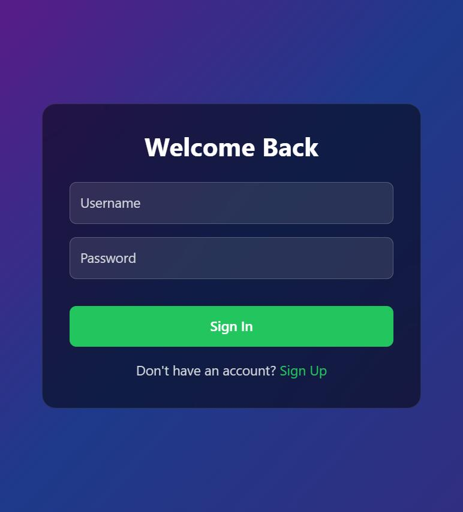
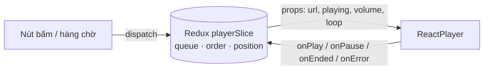
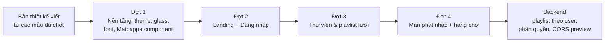

# Donatefy: nhìn lại bản v1 và hướng tới v2

> Báo cáo tổng kết bản Donatefy hiện tại (v1), các hạn chế, và hướng phát triển cho **Donatefy v2 · Matcha Cha-Cha-Cha**.
> Cập nhật: 21/10/2026 · Frontend: [donatefy.vercel.app](https://donatefy.vercel.app) · Backend: [donatefy-backend](https://github.com/duongdonate/donatefy-backend)

---

## 1. Donatefy là gì?

Donatefy là một ứng dụng nghe nhạc trên web, lấy cảm hứng từ Spotify, dùng **YouTube làm nguồn phát**. Người dùng:

1. tìm bài hát (qua YouTube Data API) hoặc dán link YouTube,
2. gom bài thành **playlist** riêng,
3. nghe ngay trên trình duyệt với trình phát có hàng chờ, xáo trộn, lặp bài.

Đây là dự án cá nhân, bắt đầu từ **07/09/2025**, ra bản **v1 ngày 28/10/2025**, và được sửa lỗi, nâng cấp dần tới nay.

|                       | Frontend                                                                                                    | Backend                                                                              |
| --------------------- | ----------------------------------------------------------------------------------------------------------- | ------------------------------------------------------------------------------------ |
| **Công nghệ sử dụng** | React 19 · Vite · Redux Toolkit · React Router · Tailwind CSS · framer-motion · react-player · lucide-react | Node.js · Express · MongoDB (Mongoose) · JWT · bcrypt · multer · YouTube Data API v3 |
| **Triển khai**        | Frontend trên Vercel                                                                                        | Backend chạy trên Render                                                             |
| **Quy mô**            | ~3.300 dòng JS/JSX ở frontend                                                                               | ~21 API endpoint ở backend                                                           |

---

## 2. Những gì đã làm được ở v1

### 2.1 Giao diện

<p align="center"></p>
<p align="center"><em>Màn hình đăng nhập v1: nền gradient tím–xanh, thẻ tối, nút xanh lá kiểu Spotify.</em></p>

<!-- Ảnh các màn hình bên trong (cần đăng nhập) sẽ được bổ sung:
     images/v1-home.jpg, images/v1-playlist.jpg, images/v1-player.jpg -->

- Bố cục **3 vùng** quen thuộc của app nghe nhạc: sidebar thư viện bên trái, nội dung ở giữa, thanh phát nhạc cố định ở đáy.
- **Sáng / tối** chuyển bằng `ThemeToggle`, màu đặt qua biến CSS (`--background`, `--primary`…) và Tailwind `darkMode: "class"`.
- Danh sách bài có **2 kiểu xem** (bảng / lưới) qua `ViewToggle`.
- Tên bài dài chạy chữ kiểu **marquee của Spotify**: chỉ chạy khi chữ tràn khung, chạy ngay khi rê chuột, lặp vô hạn liền mạch (`utils/marquee.js`).
- Có sẵn bộ **loader**, **toast** thông báo, hộp **xác nhận** (`useConfirm`), và tải **avatar** khi đăng ký.

### 2.2 Tính năng

| Nhóm | Tính năng |
|---|---|
| Tài khoản | Đăng ký (kèm avatar), đăng nhập bằng JWT, tự lấy lại phiên qua `GET /api/auth/me` |
| Tìm kiếm | Tìm video YouTube có gợi ý thả xuống (`SearchBarWithDropdown`), debounce khi gõ, lưu và xoá **lịch sử tìm kiếm** |
| Playlist | Tạo, xoá playlist; thêm nhiều bài một lúc từ videoId; gỡ bài; ảnh bìa ngẫu nhiên |
| Trình phát | Phát / tạm dừng, bài trước / sau, tua, âm lượng, tắt tiếng, **xáo trộn**, **lặp** (tắt / cả danh sách / một bài) |
| Hàng chờ | Panel "Tiếp theo": **kéo giãn** độ rộng (240–480px, nhớ lại lần sau), **kéo thả** đổi thứ tự, Alt + ↑/↓ bằng bàn phím |
| Gợi ý | `GET /api/recommend`: các video khác cùng kênh |

### 2.3 Cách tổ chức code

```
src/
├── app/          # Redux: store, slices (player, playlist), selectors
├── components/   # UI theo nhóm: MusicPlayer/, Sidebar/, SongQueue/, SearchBar/, Toast/...
├── contexts/     # Auth, Theme, Toast, Popup, MusicPlayer
├── hooks/        # useLocalStorage, useDebounce, useConfirm, useSticky...
├── layouts/      # DefaultLayout (sidebar + nội dung + player)
├── pages/        # HomePage, PlaylistPage
├── routes/       # AppRouter: /login (public), / và /playlist/:id (cần đăng nhập)
├── services/     # axiosClient + các service gọi API
└── utils/        # formatDuration, formatDate, marquee
```

**Phân chia trạng thái**

- **Redux** giữ trạng thái dùng chung toàn app: hàng chờ, bài đang phát, shuffle / repeat, âm lượng (`playerSlice`); danh sách playlist (`playlistSlice`).
- **Context** cho những thứ ít thay đổi: người dùng đăng nhập, theme, toast.
- **State cục bộ** cho thứ chỉ một component cần: thời gian đang phát, buffering, ô nhập tìm kiếm.

**Luồng phát nhạc một chiều** (đã tái cấu trúc ở đợt sửa lỗi 1)



Redux quyết định **phát bài nào**, `ReactPlayer` chỉ lo **phát bài đó**. Hai bên không còn tự sửa trạng thái của nhau nên không còn lỗi "bấm play mà nhạc không chạy" hay tự nhảy bài.

Một vài chi tiết đáng chú ý trong `playerSlice`:

- Shuffle dùng **Fisher–Yates** và giữ bài đang phát ở đầu, nên bật shuffle không làm đổi bài.
- `errorStreak` đếm số bài lỗi liên tiếp, để video bị chặn không làm trình phát **bỏ qua vô hạn**.
- Thời gian chạy và buffering **không** đưa vào Redux, tránh cả app render lại mỗi giây.

### 2.4 Backend

- REST API gồm 6 nhóm: Auth, YouTube, Songs, Playlists, History, Avatars. Tài liệu OpenAPI đầy đủ, mở ngay tại địa chỉ gốc `/` của backend (Redoc).
- Kết quả YouTube được **cache 10 phút** (`node-cache`), có header `X-Cache: hit/miss`, và tự thử lại khi bị giới hạn (`axios-retry` với lỗi 429 / 503).
- Mật khẩu băm bằng **bcrypt**; JWT hết hạn sau 1 giờ.

---

## 3. Hạn chế của v1

### 3.1 Trải nghiệm & giao diện

- **Chưa có bản sắc riêng.** README còn gọi là "Spotify Clone"; màu tím–xanh và nút xanh lá trông giống mọi bản clone khác. Repo đã có sẵn icon matcha, chasen nhưng chưa thành một ngôn ngữ thiết kế thống nhất.
- **Chưa thân thiện điện thoại.** Các component gần như không có breakpoint responsive (`sm:` / `md:` / `lg:`).
- **Tính năng dở dang:**
  - Nút **Liked Songs** trỏ tới `/liked-songs`, nhưng route này chưa có.
  - Popup **Lyrics** có giao diện, nhưng backend không có lời bài hát.
- Ảnh bìa playlist là ảnh **ngẫu nhiên mỗi lần tải**, nên cùng một playlist mỗi lần mở lại có bìa khác.

### 3.2 Kỹ thuật frontend

- **Đăng nhập còn mỏng:**
  - token nằm trong `localStorage`, dễ lộ nếu trang dính lỗi XSS;
  - không có refresh token, nên hết 1 giờ là phải đăng nhập lại;
  - interceptor gắn token đang bị comment, mỗi lệnh gọi API phải tự truyền header.
- **Lỗi 401 chưa được xử lý chung:** token hết hạn chỉ in ra console, không đưa người dùng về trang đăng nhập.
- **Ít test:** chỉ có test cho `playerSlice` và `marquee`; chưa có test giao diện hay luồng đầu-cuối.
- **Khai báo dependency sai chỗ:** các thư viện chạy thật (`redux`, `axios`, `react-router-dom`, `react-player`…) nằm trong `devDependencies`. Build vẫn chạy, nhưng dễ gây lỗi khi đổi cách cài.
- **Chưa có TypeScript:** dữ liệu API (song, playlist…) không có kiểu, nên sai tên trường chỉ lộ ra lúc chạy.

### 3.3 Backend & dữ liệu

- **Dữ liệu chưa tách theo người dùng.** Playlist có trường `userId` nhưng chưa dùng: mọi người thấy **cùng một** danh sách playlist và lịch sử tìm kiếm.
- **Thiếu phân quyền:** ngoài `GET /api/auth/me`, mọi route đều không kiểm tra đăng nhập, nên ai cũng tạo hoặc xoá được playlist.
- **Quota YouTube thấp:** mỗi lần tìm tốn 100 / 10.000 đơn vị quota mỗi ngày, tức chỉ khoảng **100 lượt tìm mỗi ngày** cho toàn hệ thống. Cache 10 phút giúp được phần nào.
- **Hiệu năng truy vấn:**
  - `GET /api/songs?playlistId=` tải **toàn bộ** bài hát rồi mới lọc;
  - ảnh bìa đọc thư mục bằng `readdirSync` cho **từng** playlist;
  - playlist không tồn tại thì trả lỗi 500 thay vì 404.
- **CORS** chỉ cho phép đúng một địa chỉ (`FRONTEND_URL`), nên các link xem thử (preview) của Vercel không gọi được API.

---

## 4. Hướng phát triển: cập nhật xu hướng

### 4.1 Xu hướng thiết kế đang lên

| Xu hướng | Ở đâu | Áp vào Donatefy v2 |
|---|---|---|
| **Kính mờ trở lại** (glassmorphism, "Liquid Glass") | Apple đưa ngôn ngữ kính vào toàn bộ hệ điều hành từ 2025; nhiều app nghe nhạc làm thanh điều khiển nổi bằng kính | Thanh điều khiển, hàng chờ, header đều là lớp **kính mờ** nổi trên ảnh bìa |
| **Nhân vật thương hiệu** | Duolingo, các app có linh vật biết phản ứng | Mascot **Matcappa** đi theo người dùng, đổi tư thế theo trạng thái nhạc |
| **Hoài cổ analog** | Đĩa than bán chạy trở lại; giao diện "đồ vật thật" (tactile) | Đĩa than **latte-matcha quay** làm trung tâm màn hình phát nhạc |
| **Thiết kế "chậm", ấm áp** (calm tech, cozy) | Lofi, app thiền; xu hướng giảm thông báo và rối mắt | "Nghe nhạc chậm lại, như pha một chén trà"; nút tự ẩn khi không cần |
| **Một màn hình, ít điều hướng** | Now Playing toàn màn hình, dock ảnh bìa kiểu macOS | Màn phát nhạc tập trung: đĩa ở giữa, dải bìa ở đáy để lướt bài |
| **Chuyển động có chủ đích** | View Transitions API đã có trên các trình duyệt lớn; micro-interaction | Ảnh bìa "bay" từ dock lên khi mở hàng chờ; tôn trọng `prefers-reduced-motion` |

### 4.2 Xu hướng kỹ thuật

- **PWA + Media Session API:** cài app lên máy, điều khiển nhạc từ màn hình khoá hoặc phím media, hiện ảnh bìa trên thông báo hệ thống.
- **Tách server state khỏi client state:** dùng TanStack Query (hoặc RTK Query vì đã có Redux Toolkit) cho dữ liệu API, có cache, tự tải lại và cập nhật lạc quan. Redux chỉ giữ trạng thái trình phát.
- **TypeScript dần dần:** bắt đầu từ kiểu `Song` / `Playlist` dùng chung giữa các service.
- **Đăng nhập an toàn hơn:** refresh token trong cookie `httpOnly`, access token ngắn hạn, interceptor tự làm mới token.
- **Kiểm thử:** Vitest cho logic, Playwright cho luồng chính (đăng nhập → tạo playlist → phát nhạc).
- **AI hỗ trợ có chừng mực:** gợi ý playlist theo tâm trạng hoặc theo một câu mô tả ("nhạc nhẹ để đọc sách"), đặt tên playlist tự động.

### 4.3 Tính năng mới đáng làm

1. **Playlist theo từng người dùng** + phân quyền ở backend: việc phải làm trước tiên.
2. **Chia sẻ playlist** bằng link (backend đã trả `shareUrl`) và trang xem công khai không cần đăng nhập.
3. **Liked Songs** thật sự (route + API).
4. **Responsive** cho điện thoại và máy tính bảng.
5. **Lời bài hát** qua một nguồn lyrics bên ngoài, hoặc bỏ hẳn nút này cho gọn.

---

## 5. Donatefy v2 · Matcha Cha-Cha-Cha

v2 không chỉ là "clone Spotify đẹp hơn". Nó là một **quán matcha có bán đĩa nhạc**: nghe nhạc thong thả, giao diện ấm, có một bé linh vật đi cùng.

### 5.1 Ngôn ngữ thiết kế

- **Màu matcha:** `#a7c4a7` · `#87a96b` · `#688e31` · `#497300`, nền kem `#f4f1df`.
- **Kính mờ** theo class `.glass` sẵn có của dự án.
- **Font:** Be Vietnam Pro cho nội dung; Yellowtail và Dancing Script cho chữ viết tay.
- **Đĩa than latte-matcha** quay theo nhạc; **loader** là cây chasen đánh trà.

### 5.2 Bản mẫu đã chốt

<p align="center"></p>
<p align="center"><em>Landing cuộn từng bước (3 bước). Bé Matcappa nổi ở góc, bay sang góc khác khi đổi bước, và nói chuyện khi rê chuột lại gần.</em></p>

<p align="center"></p>
<p align="center"><em>Matcappa: đầu kẹo dẻo, chong chóng hai lá trà (quay khi đang phát nhạc, rủ xuống khi tạm dừng). Bốn tư thế gắn với trạng thái của trình phát.</em></p>

<p align="center"></p>
<p align="center"><em>Màn phát nhạc: đĩa than ở trung tâm, thanh kính bên phải (shuffle, hàng chờ, âm lượng dọc), dock ảnh bìa ở đáy.</em></p>

<p align="center"></p>
<p align="center"><em>Chi tiết playlist dạng lưới ảnh 16:9: rê chuột hiện nút phát, gỡ bài, tay nắm kéo thả; ô cuối là "+ Thêm bài".</em></p>

### 5.3 So sánh nhanh

|               | v1                      | v2                                      |
| ------------- | ----------------------- | --------------------------------------- |
| **Bản sắc**       | Clone Spotify, tím–xanh | Quán matcha + đĩa than, có mascot       |
| **Màn phát nhạc** | Thanh điều khiển ở đáy  | Đĩa than toàn màn hình, nút tự ẩn       |
| **Hàng chờ**      | Panel bên phải          | Lớp phủ kính, ảnh bìa bay từ dock       |
| **Danh sách bài** | Bảng / lưới             | Lưới ảnh 16:9, kéo thả trực tiếp        |
| **Chuyển động**   | Ít                      | Có chủ đích, tôn trọng giảm chuyển động |
| **Dữ liệu**       | Dùng chung mọi người    | Theo từng người dùng (kế hoạch)         |

### 5.4 Kế hoạch phát triển



- **Giữ nguyên** logic đã ổn định: Redux store, các service API, hooks, contexts, router.
- **Làm lại** toàn bộ phần hiển thị: `components/`, `pages/`, `layouts/`, CSS.
- **Mỗi đợt** là một nhánh có link xem thử riêng trên Vercel. Duyệt xong mới merge vào `main`, nên link `donatefy.vercel.app` giữ nguyên.

---

> Hải Dương 2026

