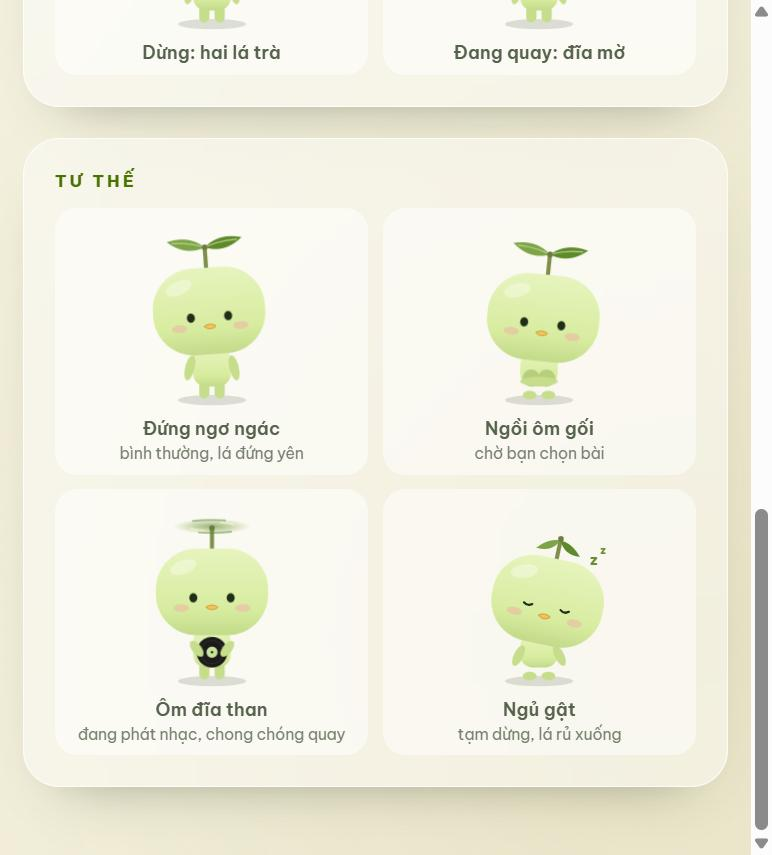
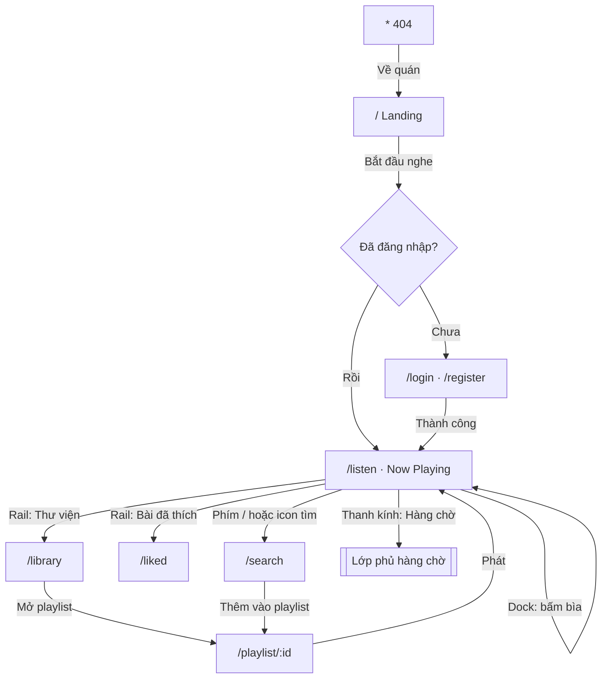
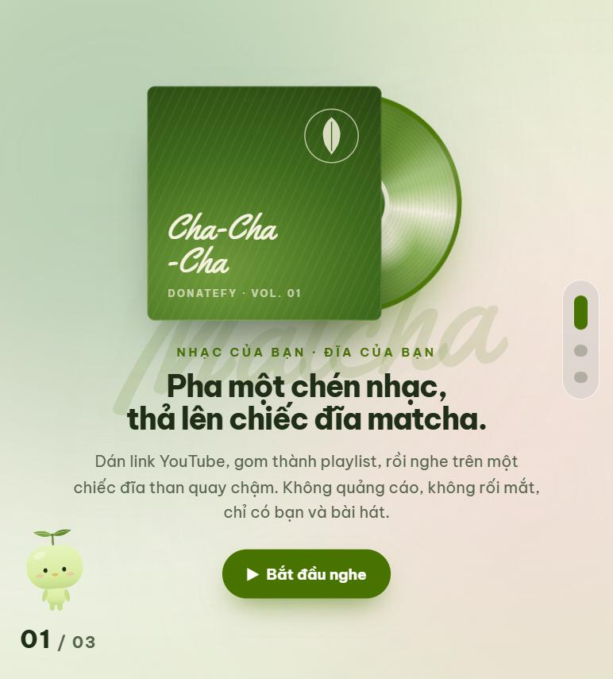
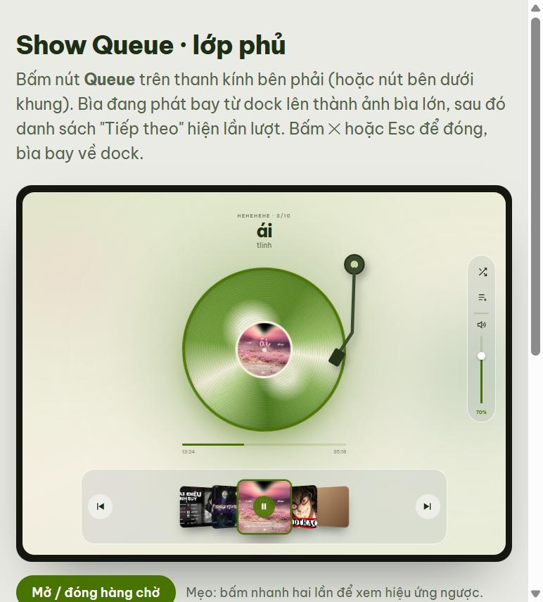
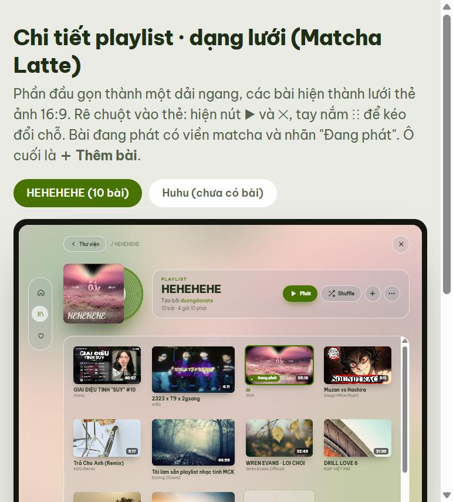
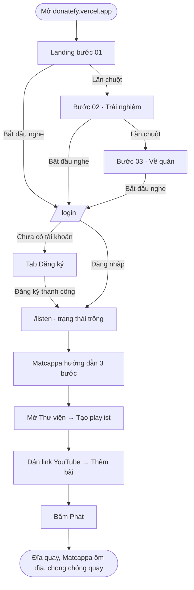
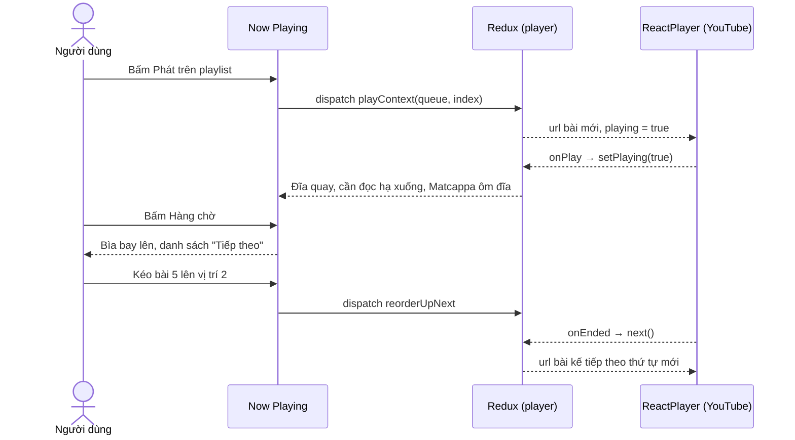
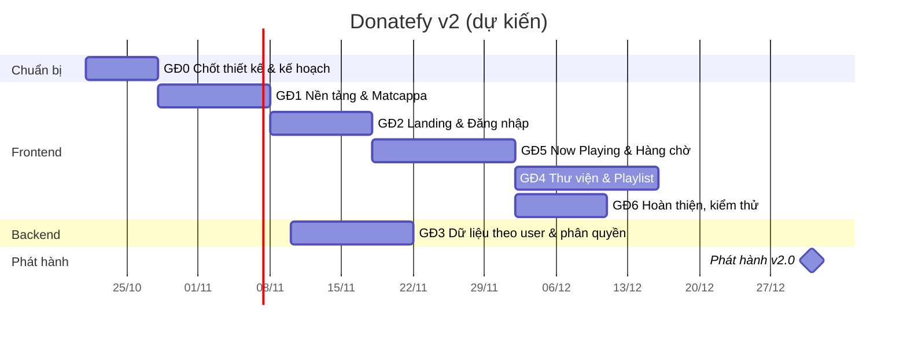

# Kế hoạch phát triển Donatefy v2 · Matcha Cha-Cha-Cha

> Tài liệu kế hoạch cho bản Donatefy mới: những gì đã thống nhất, các trang và chức năng cần làm, yêu cầu, luồng người dùng, lịch dự kiến, kết quả mong đợi và kiểm thử.
>
> Phiên bản tài liệu: 1.0 · Ngày lập: 21/10/2026 · Người phụ trách: Hải Dương
> Tài liệu liên quan: [Báo cáo nhìn lại v1](donatefy-v1-review.md) · Bản mẫu giao diện trong `.superpowers/brainstorm/`

---

## Mục lục

1. [Tóm tắt](#1-tóm-tắt)
2. [Những gì đã thống nhất](#2-những-gì-đã-thống-nhất)
3. [Thương hiệu](#3-thương-hiệu)
4. [Hệ thống thiết kế](#4-hệ-thống-thiết-kế)
5. [Sơ đồ trang (routemap)](#5-sơ-đồ-trang-routemap)
6. [Các trang cần làm](#6-các-trang-cần-làm)
7. [Yêu cầu chức năng](#7-yêu-cầu-chức-năng)
8. [Yêu cầu phi chức năng](#8-yêu-cầu-phi-chức-năng)
9. [Luồng người dùng](#9-luồng-người-dùng)
10. [Thay đổi ở backend](#10-thay-đổi-ở-backend)
11. [Kiến trúc frontend](#11-kiến-trúc-frontend)
12. [Lộ trình, deadline và kết quả mong đợi](#12-lộ-trình-deadline-và-kết-quả-mong-đợi)
13. [Kiểm thử](#13-kiểm-thử)
14. [Ưu điểm và hạn chế của hướng v2](#14-ưu-điểm-và-hạn-chế-của-hướng-v2)
15. [Rủi ro và cách xử lý](#15-rủi-ro-và-cách-xử-lý)
16. [Quy trình làm việc](#16-quy-trình-làm-việc)
17. [Những việc chưa chốt](#17-những-việc-chưa-chốt)
18. [Ngoài phạm vi v2](#18-ngoài-phạm-vi-v2)
19. [Phụ lục](#19-phụ-lục)

---

## 1. Tóm tắt

Donatefy v1 là một ứng dụng nghe nhạc YouTube chạy được, có trình phát, playlist và đăng nhập. Nhưng nó trông giống mọi bản "Spotify clone" khác, chưa dùng tốt trên điện thoại, và dữ liệu chưa tách theo người dùng (xem [báo cáo v1](donatefy-v1-review.md#3-hạn-chế-của-v1)).

**Donatefy v2** giữ lại phần lõi đã ổn định (logic phát nhạc, Redux, API) và làm lại toàn bộ phần nhìn, theo một ý tưởng riêng: **một quán matcha có bán đĩa nhạc**. Người dùng không "dùng app nghe nhạc", mà ghé quán, chọn một chồng đĩa, và nghe thong thả.

| Mục tiêu | Đo bằng |
|---|---|
| Có bản sắc riêng, nhìn là nhận ra | Bộ thiết kế matcha + kính mờ + đĩa than + mascot Matcappa áp đồng bộ cho mọi trang |
| Trải nghiệm nghe tập trung | Màn phát nhạc chỉ còn đĩa than, dock ảnh bìa và một thanh kính; nút phụ tự ẩn |
| Dùng được trên mọi màn hình | Hiển thị đúng từ 360px (điện thoại) đến 1920px |
| Dữ liệu riêng tư cho từng người | Playlist, lịch sử, bài yêu thích gắn với tài khoản; API kiểm tra quyền |
| Chất lượng ổn định | 8 testcase chính qua; không lỗi console; Lighthouse Accessibility ≥ 90 |

**Thời gian dự kiến:** 21/10/2026 → **31/12/2026** (khoảng 10 tuần, làm bán thời gian).

---

## 2. Những gì đã thống nhất

### 2.1 Giữ lại từ v1

| Phần | Lý do giữ |
|---|---|
| **Luồng phát nhạc một chiều** Redux → ReactPlayer (`playerSlice`: `queue`, `order`, `position`, shuffle Fisher–Yates, `errorStreak`) | Đã sửa và kiểm chứng ở đợt 1, hết lỗi phát / dừng sai |
| **Redux store** (`app/store.js`, slices, selectors) | Trạng thái trình phát và playlist vẫn đúng mô hình |
| **Các service gọi API** (`services/api/*`, `axiosClient`) | Hợp đồng API giữ nguyên, chỉ bổ sung |
| **Hooks** (`useLocalStorage`, `useDebounce`, `useConfirm`…) và **contexts** (Auth, Theme, Toast) | Dùng chung được cho giao diện mới |
| **Marquee kiểu Spotify** (`utils/marquee.js`) | Đã hoàn thiện ở đợt 2 |
| **Hàng chờ kéo thả, kéo giãn** (`reorderUpNext`, `playAt`) | Logic dùng lại cho lớp phủ hàng chờ mới |
| **Đường dẫn `/playlist/:id`** | Backend đã trả `shareUrl` theo dạng này; đổi sẽ làm hỏng link chia sẻ |
| **Công nghệ:** React 19, Vite, Tailwind, framer-motion, react-player, lucide-react | Không đổi stack, tránh rủi ro |
| **Backend** Express + MongoDB, API docs OpenAPI | Chỉ bổ sung phân quyền và dữ liệu theo người dùng |

### 2.2 Làm mới

| Phần | v1 | v2 |
|---|---|---|
| Giao diện | Tím–xanh, nút xanh lá kiểu Spotify | Matcha, kính mờ, đĩa than, kem ấm |
| Trang đầu | Vào thẳng trang đăng nhập | **Landing cuộn từng bước** giới thiệu quán |
| Đăng nhập | Thẻ tối giữa màn hình | Trang kính sáng, bên cạnh là 3 bước "menu" của quán |
| Màn chính | Sidebar + nội dung + thanh phát ở đáy | **Now Playing toàn màn hình**: đĩa than ở giữa, dock ảnh bìa ở đáy, header và rail tự ẩn |
| Điều khiển | Thanh ngang ở đáy | **Thanh kính dọc bên phải** (Shuffle, Hàng chờ, âm lượng dọc) |
| Hàng chờ | Panel cố định bên phải | **Lớp phủ kính**, ảnh bìa bay từ dock lên |
| Thư viện | Danh sách trong sidebar | Lớp phủ mở từ rail |
| Chi tiết playlist | Bảng / lưới | **Lưới thẻ ảnh 16:9**, rê chuột hiện nút, kéo thả đổi chỗ |
| Tải trang | Loader chung | **Chasen đánh matcha** (vòng 0,8s, quẹt 0,3s) |
| Linh vật | Không có | **Matcappa** đi cùng người dùng |
| Màn hình nhỏ | Gần như không hỗ trợ | Responsive đầy đủ |

### 2.3 Đã thử và bỏ

| Ý tưởng | Lý do bỏ |
|---|---|
| Landing 3D "bước vào quán" (Three.js) | Nặng, giật lag trên máy yếu |
| Nút Shuffle, Queue, âm lượng dạng 3D | Nhìn rối, không hợp kính mờ |
| Mascot tự phát sáng | Chói, không hợp tông vintage ấm |
| Mascot né chuột khi rê lại gần | Gây khó chịu; thay bằng bong bóng câu nói |
| Lời bài hát (lyrics) | Không có nguồn dữ liệu ổn định; để sau |

---

## 3. Thương hiệu

### 3.1 Tên và định vị

- **Tên sản phẩm:** Donatefy
- **Tên "quán" (chủ đề v2):** Matcha Cha-Cha-Cha
- **Định vị:** *Một quán matcha có bán đĩa nhạc.* Nghe nhạc YouTube theo kiểu cũ: chọn từng bài, xếp từng chồng đĩa, rồi để nó quay.
- **Không phải:** một Spotify thu nhỏ, một app khám phá nhạc theo thuật toán.

### 3.2 Khẩu hiệu và giọng văn

| | |
|---|---|
| Khẩu hiệu chính | **Pha một chén nhạc, thả lên chiếc đĩa matcha.** |
| Câu về quán | **Nghe nhạc chậm lại, như pha một chén trà.** |
| Câu chốt | **Thong thả thôi ~** |
| Giọng văn | Tiếng Việt thân mật, nhẹ nhàng, câu ngắn. Mascot xưng "mình", gọi người dùng là "bạn". Không dùng từ kỹ thuật với người dùng. |
| Tránh | Giọng quảng cáo, dấu chấm than dồn dập, emoji tràn lan |

**Ví dụ chuyển đổi câu chữ v1 → v2**

| Chỗ | v1 | v2 |
|---|---|---|
| Nút đăng nhập | Sign In | Vào quán |
| Tiêu đề đăng nhập | Welcome Back | Mở lại chồng đĩa của bạn |
| Nút chính | Play | Bắt đầu nghe |
| Playlist trống | (trống) | Chồng đĩa này chưa có bài nào. Dán một link YouTube để thả đĩa đầu tiên nha ~ |
| Lỗi mạng | Network Error | Quán đang mất sóng một chút, bạn thử lại sau nhé. |

### 3.3 Mascot Matcappa

<p align="center"></p>

| Đặc điểm | Quy định |
|---|---|
| Hình dáng | Đầu kẹo dẻo (khối bo tròn) màu `#d8eca0`; thân và chân dài khoảng ½ chiều cao đầu; tay chân mảnh, tròn đầu |
| Mặt | Hai chấm mắt nhỏ, má hồng nhạt, mỏ vàng xíu (gợi ý loài kappa) |
| Trên đầu | Cọng trà và hai lá trơn, như chong chóng tre |
| Chong chóng | Đang phát nhạc thì quay, hiện thành **một đĩa mờ** có vệt chạy vòng (không thấy cánh); dừng thì hiện lá; tạm dừng thì lá rủ |
| Không được | Phát sáng, đổ bóng dưới chân, đội mũ hay đeo phụ kiện, vẽ 3D |
| Kỹ thuật | SVG 2D, một component dùng chung cho mọi trang |

**Tư thế theo trạng thái**

| Tư thế | Khi nào |
|---|---|
| Đứng ngơ ngác | Bình thường, chưa phát nhạc |
| Ngồi ôm gối | Chờ người dùng chọn bài / danh sách trống |
| Ôm đĩa than, chong chóng quay | Đang phát nhạc |
| Ngủ gật, lá rủ, chữ "z" | Tạm dừng |
| Che mắt / nhảy lên | Khi bị bấm vào |

**Hành vi trên landing**

- Luôn nổi trên màn hình, không bao giờ biến mất.
- Đổi bước thì bé bật chong chóng và bay theo đường cong sang góc khác: bước 1 góc dưới-trái, bước 2 góc trên-phải, bước 3 góc dưới-phải.
- Chuột lại gần: bé **đứng yên** và hiện bong bóng câu nói.
  - Câu tự tắt sau khoảng 2,6 giây.
  - Mỗi lần chuột vào lại thì đổi câu, không lặp đúng câu vừa nói.
  - Bong bóng rộng tối đa 360px, không có nút, không có hiệu ứng "đang gõ".

---

## 4. Hệ thống thiết kế

### 4.1 Màu

| Tên | Mã | Dùng cho |
|---|---|---|
| Matcha 1 | `#a7c4a7` | Nền phụ, vệt sáng |
| Matcha 2 | `#87a96b` | Viền, icon phụ |
| Matcha 3 | `#688e31` | Chữ nhấn, chữ viết tay |
| Matcha 4 | `#497300` | Nút chính, trạng thái đang phát |
| Kem | `#f4f1df` | Nền chính |
| Mực | `#1f2e17` | Chữ chính |
| Chữ phụ | `#55624c` | Mô tả, chú thích |
| Mascot | `#d8eca0` | Thân Matcappa |

Chế độ tối giữ cùng bảng màu, đảo độ sáng nền. Cần chốt bảng màu tối trước khi vào giai đoạn 1.

> Lưu ý kỹ thuật: Tailwind đang khai báo `primary = var(--primary)`, nên các modifier độ mờ như `bg-primary/50` không chạy. Giai đoạn 1 cần khai báo màu dạng kênh RGB để sửa.

### 4.2 Chữ

| Font | Dùng cho |
|---|---|
| **Be Vietnam Pro** (400–800) | Toàn bộ nội dung |
| **Yellowtail** | Chữ viết tay **không dấu**: "Matcha Cha-Cha-Cha", "Cha-Cha-Cha", số thứ tự |
| **Dancing Script** | Chữ viết tay **tiếng Việt có dấu**: "Thong thả thôi ~" |

Yellowtail không có dấu tiếng Việt, tuyệt đối không dùng cho câu tiếng Việt.

### 4.3 Kính mờ

- Dựa trên class `.glass` có sẵn trong `src/App.css`: nền xám mờ 20% + viền sáng; chế độ tối dùng xám đậm hơn.
- Độ mờ (`backdrop-filter: blur`) thêm tại chỗ dùng, mặc định 18px.
- Không chồng quá 2 lớp kính lên nhau (nặng máy, khó đọc chữ).

### 4.4 Thành phần đặc trưng

| Thành phần | Mô tả |
|---|---|
| Đĩa than latte-matcha | Vòng màu matcha xen kem, nhãn giữa là ảnh bìa bài; quay khi phát, dừng khi tạm dừng |
| Cần đọc | Đặt lên đĩa khi phát, nhấc ra khi dừng |
| Loader chasen | Chén chawan nhìn nghiêng, chasen đi vòng quanh miệng chén (0,8s) và quẹt qua lại (0,3s), bọt nổi lên |
| Bìa đĩa | Vuông, bo góc nhẹ, đổ bóng mềm; bìa đang phát có viền matcha |

### 4.5 Chuyển động

- Mọi chuyển động phải **có lý do**: báo trạng thái, dẫn mắt, hoặc nối hai màn hình.
- Thời lượng chuẩn: 200ms (nhỏ), 400ms (vừa), 900ms (chuyển cảnh).
- Đường cong mặc định: `cubic-bezier(.2,.8,.2,1)`.
- Khi người dùng bật **giảm chuyển động** (`prefers-reduced-motion`): tắt đĩa quay, mascot bay, hiệu ứng bay bìa; chỉ giữ đổi trạng thái tức thì.

---

## 5. Sơ đồ trang (routemap)

### 5.1 Danh sách đường dẫn

| Đường dẫn | Trang | Quyền | Ghi chú |
|---|---|---|---|
| `/` | Landing | Công khai | Đã đăng nhập thì nút "Bắt đầu nghe" đi thẳng vào `/listen` |
| `/login` | Đăng nhập | Công khai | Đã đăng nhập thì chuyển về `/listen` |
| `/register` | Đăng ký | Công khai | Cùng trang với đăng nhập, đổi tab |
| `/listen` | **Now Playing** (giao diện chính) | Cần đăng nhập | Thay cho `/` của v1 |
| `/library` | Thư viện playlist | Cần đăng nhập | Lớp phủ trên Now Playing |
| `/playlist/:id` | Chi tiết playlist | Cần đăng nhập (chủ playlist) | Giữ nguyên đường dẫn v1 cho link chia sẻ |
| `/liked` | Bài đã thích | Cần đăng nhập | Giai đoạn 4 |
| `/search` | Tìm kiếm | Cần đăng nhập | Lớp phủ, mở bằng phím `/` |
| `*` | Không tìm thấy (404) | Công khai | Matcappa ngồi ôm gối, nút về quán |

**Lớp phủ có đường dẫn riêng.** `/library`, `/playlist/:id`, `/search` mở **đè lên** Now Playing chứ không thay trang. Vì vậy nhạc không bị ngắt khi chuyển trang, và nút Back của trình duyệt đóng lớp phủ.

### 5.2 Sơ đồ



---

## 6. Các trang cần làm

### 6.1 Landing (`/`)

<p align="center"></p>

- **Cấu trúc:** cuộn từng bước, 3 bước; mỗi lần lăn chuột chỉ sang 1 bước.

| Bước | Nội dung | Mascot |
|---|---|---|
| 01 · Giới thiệu | Bìa đĩa "Cha-Cha-Cha" + đĩa than trượt ra; khẩu hiệu "Pha một chén nhạc, thả lên chiếc đĩa matcha."; nút Bắt đầu nghe | Góc dưới-trái, đứng |
| 02 · Trải nghiệm | Máy tính bảng minh hoạ màn phát nhạc; "Một màn hình. Một chiếc đĩa." | Góc trên-phải, ôm đĩa |
| 03 · Về quán | Chén matcha với chasen đang đánh; "Nghe nhạc chậm lại, như pha một chén trà."; "Thong thả thôi ~" | Góc dưới-phải, ôm gối |

- **Điều hướng:** lăn chuột, phím ↑/↓/PageUp/PageDown/Home/End, vuốt trên điện thoại, chấm điều hướng bên phải, số trang `01 / 03`.
- **Nền:** chữ viết tay khổng lồ mờ đổi theo bước (Matcha → Vinyl → Cha-Cha).
- **Màn hình thấp:** nội dung tự thu nhỏ cho vừa, không bao giờ cuộn trong một bước.
- **Bản mẫu:** `landing-mascot.html`.

### 6.2 Đăng nhập / Đăng ký (`/login`, `/register`)

- **Bên trái:** "menu của quán", 3 bước:
  1. Dán link YouTube
  2. Gom thành playlist
  3. Thả lên đĩa và nghe
- **Bên phải:** thẻ kính với 2 tab Đăng nhập / Đăng ký.
- **Đăng ký:** tên tài khoản, mật khẩu, nhập lại mật khẩu, tuỳ chọn ảnh đại diện (xem trước trước khi gửi).
- **Báo lỗi** ngay dưới ô nhập: tên đã tồn tại, mật khẩu không khớp, sai tài khoản hoặc mật khẩu.
- **Điện thoại:** phần "menu" thu gọn lên trên thành một dải ngang.
- **Bản mẫu:** `auth.html`.

### 6.3 Now Playing (`/listen`): giao diện chính

<p align="center"></p>

| Vùng | Nội dung | Hành vi |
|---|---|---|
| **Header** (trên) | Logo, ô tìm kiếm, avatar + menu tài khoản, đổi sáng/tối | Hiện khi rê chuột, đứng yên 2,5 giây thì tự ẩn |
| **Rail** (trái) | Trang chủ, Thư viện, Bài đã thích | Tự ẩn cùng header |
| **Trung tâm** | Tên bài, nghệ sĩ, playlist + vị trí (vd `HEHEHEHE · 3/10`); **đĩa than** có ảnh bìa; cần đọc; thanh tiến trình + thời gian | Đĩa quay khi phát; cần đọc nhấc khi dừng |
| **Thanh kính phải** (phương án C) | Shuffle, Hàng chờ, âm lượng dọc + % | Kéo âm lượng; bấm icon loa để tắt tiếng |
| **Dock** (đáy) | Nút bài trước / sau; 5 bìa (bài giữa là bài đang phát, có nút ▶/❚❚) | Bấm bìa bên cạnh để chuyển bài; bìa hai bên nghiêng như dock |

**Trạng thái trống:** khi chưa có bài nào, đĩa trống quay chậm; Matcappa ngồi ôm gối và nói "Dán link YouTube đầu tiên với mình nha ~"; có nút "Mở thư viện".

**Bản mẫu:** `visual-direction-v3.html`, `controls-options.html` (phương án C).

### 6.4 Lớp phủ hàng chờ

- **Mở:** bấm nút Hàng chờ trên thanh kính.
- **Hiệu ứng mở:** bìa đang phát bay từ dock lên thành ảnh bìa lớn, rồi danh sách "Tiếp theo" hiện lần lượt.
- **Hai tab:** Tiếp theo / Đã phát.
- **Mỗi dòng:** tay nắm kéo thả, ảnh bìa nhỏ, tên bài (marquee khi rê chuột), thời lượng, nút phát ngay.
- **Trên ảnh bìa lớn:** nút phát / dừng, shuffle, lặp.
- **Lặp cả danh sách:** có thêm mục "Sau đó phát lại từ đầu".
- **Đóng:** ✕ hoặc Esc; bìa bay về dock.
- **Bàn phím:** Alt + ↑/↓ đổi thứ tự bài đang chọn.
- **Bản mẫu:** `queue-overlay.html`.

### 6.5 Thư viện (`/library`)

- Lớp phủ mở từ nút Thư viện trên rail, hiển thị mọi playlist của người dùng.
- **Đã chốt: A · Xoè bìa** (bản mẫu `playlists-options.html`), **bỏ hiệu ứng đĩa than trượt ra**: lớp phủ tối kiểu Groove, mỗi lúc tập trung một playlist ở giữa; lướt bằng ‹ ›, ←/→, lăn chuột hoặc bấm bìa bên cạnh.
- Bìa cuối là **Tạo playlist**; menu ⋯ để đổi tên / xoá.
- **Không có ô tìm và sắp xếp** (chấp nhận vì số playlist thường ít). Thứ tự: playlist đang phát trước, rồi mới nhất.
- Playlist đang phát có nhãn "Đang phát".

### 6.6 Chi tiết playlist (`/playlist/:id`)

<p align="center"></p>

- **Phần đầu** là một dải ngang:
  - bìa và đĩa than;
  - nhãn PLAYLIST, tên, người tạo, số bài, tổng thời lượng;
  - các nút Phát, Shuffle, Thêm bài (+), menu ⋯.
- **Danh sách bài** là lưới thẻ ảnh 16:9 (4 cột trên máy tính, 2 cột trên điện thoại).
  - Thẻ có tên bài, kênh, thời lượng.
  - Rê chuột vào thẻ: hiện nút ▶ ở giữa, nút ✕ để gỡ, tay nắm ⋮⋮ để kéo đổi chỗ.
  - Bài đang phát có viền matcha và nhãn "Đang phát".
- **Ô cuối "+ Thêm bài"** mở hộp dán link YouTube; dán được nhiều link một lúc, có xem trước trước khi thêm.
- **Playlist trống:** Matcappa ngồi ôm gối và hướng dẫn dán link.
- **Bản mẫu:** `playlist-detail-grid.html`.

### 6.7 Tìm kiếm (`/search`)

- Lớp phủ kính; mở bằng phím `/` hoặc icon kính lúp trên header.
- Gõ thì tìm sau 400ms (debounce); cần tối thiểu 2 ký tự.
- **Chưa gõ gì:** hiện lịch sử tìm kiếm của chính người dùng, mỗi mục có nút xoá, kèm nút "Xoá hết".
- **Mỗi kết quả:** nút phát ngay, nút thêm vào hàng chờ, nút thêm vào playlist (chọn playlist).
- Dán thẳng một link YouTube vào ô tìm thì nhận ra là link và đưa lên đầu kết quả.

### 6.8 Bài đã thích (`/liked`)

- Giao diện như chi tiết playlist, nhưng là danh sách đặc biệt không xoá được.
- Thả tim ở dock, ở kết quả tìm kiếm và ở thẻ bài.

### 6.9 Trang 404 và trang lỗi

- Matcappa ngồi ôm gối: "Ơ, bàn này chưa có ai đặt…"; nút **Về quán**.
- Lỗi mạng hoặc server: toast nhẹ ở góc, kèm nút Thử lại; không hiện lỗi kỹ thuật cho người dùng.

---

## 7. Yêu cầu chức năng

Ký hiệu độ ưu tiên: **P0** bắt buộc cho bản phát hành · **P1** nên có · **P2** có thì tốt.

### 7.1 Tài khoản

| Mã | Yêu cầu | Ưu tiên |
|---|---|---|
| FR-01 | Đăng ký bằng tên tài khoản (3–30 ký tự, chữ, số, `_`, `.`) và mật khẩu (tối thiểu 6 ký tự); báo lỗi nếu tên đã tồn tại | P0 |
| FR-02 | Đăng nhập; sai thông tin thì báo "Tên tài khoản hoặc mật khẩu không chính xác" mà không nói rõ sai phần nào | P0 |
| FR-03 | Tự giữ phiên đăng nhập khi tải lại trang; hết phiên thì tự làm mới token, nếu không làm mới được thì đưa về `/login` kèm thông báo | P0 |
| FR-04 | Đăng xuất: xoá phiên, dừng nhạc, quay về Landing | P0 |
| FR-05 | Tải và đổi ảnh đại diện (jpg, png, gif, tối đa 2MB, có xem trước) | P1 |

### 7.2 Trình phát

| Mã | Yêu cầu | Ưu tiên |
|---|---|---|
| FR-10 | Phát, tạm dừng, bài trước, bài sau, tua theo thanh tiến trình | P0 |
| FR-11 | Bấm "Bài trước" khi bài đã chạy quá 3 giây thì quay về đầu bài, ngược lại thì lùi bài | P1 |
| FR-12 | Shuffle: xáo thứ tự nhưng giữ bài đang phát; tắt shuffle thì về thứ tự gốc tại đúng bài đang phát | P0 |
| FR-13 | Lặp: tắt / cả danh sách / một bài | P0 |
| FR-14 | Âm lượng 0–100%, tắt tiếng, nhớ mức âm lượng giữa các lần mở | P0 |
| FR-15 | Bài bị YouTube chặn thì tự chuyển bài kế; lỗi liên tiếp 3 bài thì dừng và báo | P0 |
| FR-16 | Phím tắt: Space (phát/dừng), ←/→ (tua 5 giây), Shift + ←/→ (bài trước/sau), M (tắt tiếng), Q (hàng chờ), `/` (tìm kiếm) | P1 |
| FR-17 | Điều khiển từ màn hình khoá và phím media của máy (Media Session API): tên bài, ảnh bìa, các nút | P1 |
| FR-18 | Nhớ bài và vị trí đang nghe; mở lại thì sẵn sàng "nghe tiếp" (không tự phát) | P2 |

### 7.3 Hàng chờ

| Mã | Yêu cầu | Ưu tiên |
|---|---|---|
| FR-20 | Xem danh sách "Tiếp theo" và "Đã phát" | P0 |
| FR-21 | Kéo thả đổi thứ tự; bàn phím Alt + ↑/↓ | P0 |
| FR-22 | Bấm một bài trong hàng chờ để phát ngay | P0 |
| FR-23 | Thêm bài vào cuối hàng chờ, hoặc "phát tiếp theo" (chèn ngay sau bài hiện tại) | P1 |
| FR-24 | Gỡ bài khỏi hàng chờ | P1 |

### 7.4 Playlist

| Mã | Yêu cầu | Ưu tiên |
|---|---|---|
| FR-30 | Tạo playlist (tên 1–60 ký tự); bìa là **ảnh** do backend gán ngẫu nhiên **một lần lúc tạo** và giữ cố định *(chốt 22/10)* | P0 |
| FR-31 | Đổi tên, xoá playlist (có hỏi xác nhận) | P0 |
| FR-32 | Thêm bài bằng cách dán **một** link YouTube; tự điền tên bài và kênh (sửa được), chọn 1 trong 4 khung hình làm bìa, xem trước rồi thêm. Tên / bìa đã sửa lưu **riêng cho playlist đó**. Báo ngay nếu link hỏng hoặc bài đã có *(đổi 22/10, theo bản mẫu)* | P0 |
| FR-33 | Gỡ bài khỏi playlist (có thể hoàn tác trong 5 giây) | P0 |
| FR-34 | Kéo thả sắp xếp bài trong playlist, lưu lên server | P1 |
| FR-35 | Phát cả playlist, hoặc phát xáo trộn | P0 |
| FR-36 | Chỉ chủ playlist mới xem và sửa được | P0 |
| FR-37 | Chia sẻ playlist: sao chép link; người nhận xem được ở chế độ chỉ đọc | P2 |

### 7.5 Tìm kiếm và khám phá

| Mã | Yêu cầu | Ưu tiên |
|---|---|---|
| FR-40 | Tìm video YouTube theo từ khoá (≥ 2 ký tự), tối đa 20 kết quả | P0 |
| FR-41 | Lịch sử tìm kiếm **theo từng người dùng**, xoá từng mục hoặc xoá hết | P1 |
| FR-42 | Nhận ra link YouTube (`youtube.com/watch?v=`, `youtu.be/`, `music.youtube.com`) dán vào ô tìm | P1 |
| FR-43 | Gợi ý bài cùng kênh với bài đang phát | P2 |
| FR-44 | Thích / bỏ thích bài; trang Bài đã thích | P1 |

### 7.6 Mascot và hướng dẫn

| Mã | Yêu cầu | Ưu tiên |
|---|---|---|
| FR-50 | Component `Matcappa` với các tư thế: đứng, ôm gối, ôm đĩa, ngủ gật; chong chóng quay / dừng / rủ theo trạng thái trình phát | P0 |
| FR-51 | Mascot trên landing: bay giữa các góc khi đổi bước; nói khi chuột lại gần (tự tắt ~2,6 giây, đổi câu mỗi lần) | P0 |
| FR-52 | Mascot xuất hiện ở trạng thái trống (thư viện trống, playlist trống, chưa phát gì) và trang 404 | P1 |
| FR-53 | Lần đầu vào `/listen`: 3 bước hướng dẫn ngắn do Matcappa dẫn, có nút Bỏ qua, chỉ hiện một lần | P2 |

### 7.7 Giao diện chung

| Mã | Yêu cầu | Ưu tiên |
|---|---|---|
| FR-60 | Sáng / tối, mặc định theo cài đặt hệ thống, nhớ lựa chọn | P1 |
| FR-61 | Header và rail tự ẩn sau 2,5 giây đứng yên; hiện lại khi rê chuột, chạm màn hình hoặc dùng bàn phím | P0 |
| FR-62 | Toast thông báo ngắn cho mọi thao tác thêm / xoá / lỗi | P0 |
| FR-63 | Loader chasen khi tải trang và tải dữ liệu lâu hơn 300ms | P1 |

---

## 8. Yêu cầu phi chức năng

| Mã | Nhóm | Yêu cầu | Cách kiểm |
|---|---|---|---|
| NFR-01 | Hiệu năng | LCP < 2,5s và CLS < 0,1 trên 4G | Lighthouse (mobile) |
| NFR-02 | Hiệu năng | Bundle JS ban đầu < 250KB gzip; tách code theo trang (landing không tải trình phát) | `vite build` + báo cáo kích thước |
| NFR-03 | Hiệu năng | Hoạt ảnh chạy 60fps; chỉ animate `transform` và `opacity` | Chrome DevTools Performance |
| NFR-04 | Khả năng truy cập | Dùng được hoàn toàn bằng bàn phím; viền focus rõ ràng | Thử tay theo testcase TC-08 |
| NFR-05 | Khả năng truy cập | Tương phản chữ ≥ 4.5:1 (cả trên nền kính) | Lighthouse Accessibility ≥ 90 |
| NFR-06 | Khả năng truy cập | Tôn trọng `prefers-reduced-motion`; mọi icon có nhãn cho trình đọc màn hình | axe DevTools |
| NFR-07 | Responsive | Đúng bố cục ở 360, 768, 1024, 1440px | Thử tay + ảnh chụp |
| NFR-08 | Trình duyệt | Chrome, Edge, Firefox, Safari bản mới nhất; iOS Safari, Chrome Android | Thử tay |
| NFR-09 | Bảo mật | Token làm mới nằm trong cookie `httpOnly`; mọi API dữ liệu kiểm tra quyền sở hữu | Testcase TC-07 |
| NFR-10 | Bảo mật | Không lưu mật khẩu ở client; không log token | Đọc code |
| NFR-11 | Ổn định | Không lỗi đỏ trong console ở mọi luồng chính | Thử tay mỗi đợt |
| NFR-12 | Quota | Tìm kiếm cache 10 phút; debounce 400ms; không tìm khi < 2 ký tự | Đọc code + log `X-Cache` |

---

## 9. Luồng người dùng

### 9.1 Lần đầu ghé quán



### 9.2 Người dùng quay lại

1. Mở trang: phiên còn hạn thì bấm "Bắt đầu nghe" đi thẳng vào `/listen`.
2. Now Playing hiện bài nghe dở lần trước, sẵn sàng nghe tiếp (FR-18).
3. Lướt dock để đổi bài, hoặc mở Thư viện chọn chồng đĩa khác.

### 9.3 Vào giao diện chính và điều khiển



### 9.4 Thêm bài từ tìm kiếm

1. Bấm `/` → lớp phủ tìm kiếm → gõ "lofi chill".
2. Sau 400ms hiện kết quả; rê chuột vào một kết quả → bấm "+ Playlist" → chọn "Đêm muộn".
3. Toast: *Đã thả "Lofi Chill Mix" vào chồng đĩa Đêm muộn.*
4. Esc đóng lớp phủ, nhạc vẫn phát không ngắt.

---

## 10. Thay đổi ở backend

### 10.1 Dữ liệu

| Collection | Thay đổi |
|---|---|
| `CustomPlaylist` | `userId` **bắt buộc**; thêm `cover` (cố định lúc tạo), `updatedAt`, `isPublic` (cho chia sẻ) |
| `SearchHistory` | `userId` bắt buộc; mỗi người tối đa 50 mục |
| `LikedSong` *(mới)* | `userId`, `videoId`, `likedAt`; chỉ mục duy nhất theo cặp (`userId`, `videoId`) |
| `RefreshToken` *(mới)* | `userId`, mã băm token, hạn dùng; xoá khi đăng xuất |
| `CustomSong` | Giữ nguyên; tra cứu bằng `$in` thay vì tải toàn bộ |

**Dữ liệu cũ:** playlist và lịch sử chưa có `userId` sẽ được gán cho một tài khoản chỉ định bằng script chuyển đổi; chạy thử trên bản sao database trước.

### 10.2 API

| Việc                                         | Chi tiết                                                                                                                                                    |
| -------------------------------------------- | ----------------------------------------------------------------------------------------------------------------------------------------------------------- |
| Middleware `checkAuth` cho mọi route dữ liệu | Playlist, history, liked: chỉ thao tác trên dữ liệu của chính người gọi; không phải chủ thì trả 404                                                         |
| Làm mới token                                | `POST /api/auth/refresh` (đọc cookie `httpOnly`), `POST /api/auth/logout`                                                                                   |
| Playlist                                     | `PATCH /api/playlists/:id` (đổi tên, sắp xếp bài); thống nhất `/api/playlists/:id/songs` thay cho `/api/playlist/:id/add-song` (giữ route cũ một thời gian) |
| Liked                                        | `GET/POST/DELETE /api/liked`                                                                                                                                |
| Sửa lỗi đã biết                              | `getSongs` báo 404 khi playlist không tồn tại; đọc thư mục ảnh bìa một lần lúc khởi động; bỏ import `yamljs` thừa                                           |
| CORS                                         | Cho phép `FRONTEND_URL` và đúng các link xem thử Vercel của project (không mở `*.vercel.app`)                                                               |
| Kiểu trả về                                  | Dần thống nhất về dạng `{ status, message, data }` của helper `Res`                                                                                         |
| Tài liệu                                     | Cập nhật `docs/openapi.yml` cùng lúc với mỗi thay đổi API                                                                                                   |

---

## 11. Kiến trúc frontend

### 11.1 Thư mục đề xuất

```
src/
├── app/                 # GIỮ: store, slices, selectors
├── services/            # GIỮ: axiosClient (+ interceptor làm mới token), api/*
├── hooks/  contexts/    # GIỮ, bổ sung useIdle (tự ẩn header), useMediaSession
├── utils/               # GIỮ: marquee, format*
├── design/              # MỚI: tokens (màu, font, thời lượng), Glass, Button, IconButton
├── mascot/              # MỚI: <Matcappa pose state />, MascotSpeech, các câu thoại
├── features/
│   ├── landing/         # LandingSteps, StepNav, các Scene
│   ├── auth/            # AuthPage, SignInForm, SignUpForm
│   ├── player/          # NowPlaying, Vinyl, Tonearm, Dock, GlassBar, ProgressBar
│   ├── queue/           # QueueOverlay, QueueItem
│   ├── library/         # LibraryOverlay, PlaylistCover
│   ├── playlist/        # PlaylistDetail, SongTile, AddSongsDialog
│   └── search/          # SearchOverlay, SearchResult
├── layouts/             # AppShell (header + rail + vùng lớp phủ), PublicLayout
└── routes/              # AppRouter (định tuyến lớp phủ, chặn trang cần đăng nhập)
```

### 11.2 Nguyên tắc

- **Tách dữ liệu server khỏi trạng thái trình phát.** Dữ liệu từ API (playlist, kết quả tìm kiếm) dùng RTK Query, có sẵn trong Redux Toolkit, để có cache và tự tải lại. Redux slice chỉ giữ trạng thái trình phát.
- **Trình phát nằm ở `AppShell`** và không bao giờ bị huỷ khi đổi trang, nên nhạc không ngắt.
- **Định tuyến lớp phủ:** dùng `location.state.background` của React Router để vẽ lớp phủ đè lên trang nền.
- **Mỗi component dưới 200 dòng;** quá thì tách nhỏ.
- **Sửa khai báo dependency:** chuyển các thư viện chạy thật từ `devDependencies` sang `dependencies`.
- **TypeScript:** không bắt buộc ở v2. Có thể bắt đầu bằng JSDoc cho kiểu `Song`, `Playlist`.

---

## 12. Lộ trình, deadline và kết quả mong đợi

### 12.1 Tổng quan



| Giai đoạn | Nội dung | Thời gian |
|---|---|---|
| GĐ0 | Chốt thiết kế & kế hoạch | 21/10 → 27/10 |
| GĐ1 | Nền tảng & Matcappa (frontend) | 28/10 → 07/11 |
| GĐ2 | Landing & Đăng nhập (frontend) | 08/11 → 17/11 |
| GĐ3 | Dữ liệu theo user & phân quyền (backend, song song) | 10/11 → 21/11 |
| GĐ5 | Now Playing & Hàng chờ (frontend, làm trước GĐ4) | 18/11 → 01/12 |
| GĐ4 | Thư viện & Playlist (frontend) | 02/12 → 15/12 |
| GĐ6 | Hoàn thiện, kiểm thử | 16/12 → 26/12 |
| 🚩 | **Phát hành v2.0** | **31/12** |

### 12.2 Chi tiết từng giai đoạn

#### GĐ0 · Chốt thiết kế và kế hoạch: 21/10 → 27/10

| Việc | Kết quả mong đợi |
|---|---|
| Chốt 2 việc còn treo (mục 17) | Ghi vào tài liệu này |
| Commit nhánh `feat/queue-resize-reorder`, tạo nhánh `v2/foundation` | Nhánh sạch để bắt đầu |
| Viết bản thiết kế chi tiết từ các bản mẫu | `docs/superpowers/specs/…-ui-rebuild-design.md` được duyệt |
| Chụp ảnh các màn hình v1 (cần đăng nhập) | Bổ sung vào báo cáo v1 |

#### GĐ1 · Nền tảng và Matcappa: 28/10 → 07/11

| Việc | Kết quả mong đợi |
|---|---|
| Design tokens: màu (cả sáng và tối), font, bo góc, thời lượng chuyển động; sửa màu Tailwind để dùng được độ mờ | `design/tokens`, cấu hình Tailwind mới |
| Component nền: `Glass`, `Button`, `IconButton`, `Toast`, loader chasen | Trang `/dev/ui` (chỉ ở môi trường dev) trưng bày đủ component |
| Component `Matcappa` (4 tư thế, 3 trạng thái chong chóng, bong bóng nói) | Dùng lại được ở mọi trang |
| `AppShell`: header + rail tự ẩn, vùng lớp phủ, định tuyến lớp phủ | Khung chạy được, chưa có nội dung |
| Chuyển dependency sang đúng mục | `package.json` sạch |

#### GĐ2 · Landing và Đăng nhập: 08/11 → 17/11

| Việc | Kết quả mong đợi |
|---|---|
| Landing 3 bước + mascot bay / nói | `/` giống bản mẫu `landing-mascot.html` |
| Trang Đăng nhập / Đăng ký mới | `/login`, `/register` chạy với backend thật |
| Chuyển hướng theo trạng thái đăng nhập | Đúng sơ đồ mục 5.2 |
| Link xem thử Vercel cho nhánh | Bấm xem được (sau khi sửa CORS ở GĐ3) |

#### GĐ3 · Backend: dữ liệu theo người dùng và phân quyền: 10/11 → 21/11 (song song)

| Việc | Kết quả mong đợi |
|---|---|
| `userId` cho playlist và lịch sử; script chuyển dữ liệu cũ | Mỗi người chỉ thấy dữ liệu của mình |
| `checkAuth` cho mọi route dữ liệu; refresh token qua cookie `httpOnly` | Testcase TC-07 qua |
| Bìa playlist cố định; sửa `getSongs`; đọc thư mục ảnh một lần | Hết lỗi đã liệt kê trong báo cáo v1 |
| CORS cho link xem thử | Bản xem thử gọi được API |
| Cập nhật `openapi.yml` | Redocly lint 0 lỗi |

#### GĐ4 · Thư viện và Playlist: 02/12 → 15/12 (làm sau GĐ5)

| Việc | Kết quả mong đợi |
|---|---|
| Lớp phủ Thư viện (theo phương án đã chốt) | Tạo, mở, đổi tên, xoá playlist |
| Chi tiết playlist dạng lưới 16:9 | Kéo thả, gỡ bài (có hoàn tác), thêm bài nhiều link |
| Tìm kiếm dạng lớp phủ + lịch sử theo người dùng | FR-40 → FR-42 |
| Bài đã thích | FR-44 |

#### GĐ5 · Now Playing và Hàng chờ: 18/11 → 01/12 (làm trước GĐ4)

| Việc | Kết quả mong đợi |
|---|---|
| Đĩa than, cần đọc, tiến trình, dock 5 bìa | Màn hình chính giống bản mẫu |
| Thanh kính phải (phương án C) | Shuffle, hàng chờ, âm lượng dọc |
| Lớp phủ hàng chờ, hiệu ứng bìa bay | Như bản mẫu `queue-overlay.html` |
| Phím tắt, Media Session | FR-16, FR-17 |
| Mascot theo trạng thái trình phát; trạng thái trống | FR-50, FR-52 |

#### GĐ6 · Hoàn thiện và kiểm thử: 16/12 → 26/12

| Việc | Kết quả mong đợi |
|---|---|
| Responsive 360 → 1440px | Ảnh chụp 4 kích thước cho mỗi trang |
| Khả năng truy cập, giảm chuyển động | Lighthouse Accessibility ≥ 90 |
| Hiệu năng, tách code | NFR-01, NFR-02 đạt |
| Chạy toàn bộ testcase mục 13 | Biên bản kiểm thử, 8/8 qua |
| Cập nhật README | Ảnh chụp v2, hướng dẫn chạy |

#### Phát hành: 27/12 → 31/12

- Merge các nhánh vào `main`; Vercel tự triển khai lên `donatefy.vercel.app`.
- Theo dõi lỗi 3 ngày đầu; có sẵn cách quay về bản v1 (redeploy commit cũ trên Vercel).
- Gắn tag `v2.0.0`.

### 12.3 Bảng tổng hợp kết quả bàn giao

| # | Kết quả | Hạn |
|---|---|---|
| 1 | Tài liệu kế hoạch (tài liệu này) và bản thiết kế chi tiết được duyệt | 27/10 |
| 2 | Bộ component nền + Matcappa + khung `AppShell` | 07/11 |
| 3 | Landing + Đăng nhập chạy trên link xem thử | 17/11 |
| 4 | Backend phân quyền, dữ liệu theo người dùng, API docs cập nhật | 21/11 |
| 5 | Now Playing, hàng chờ, phím tắt, Media Session | 01/12 |
| 6 | Thư viện, chi tiết playlist, tìm kiếm, bài đã thích | 15/12 |
| 7 | Bản hoàn thiện: responsive, truy cập, hiệu năng, kiểm thử đạt | 26/12 |
| 8 | **Donatefy v2.0 lên `donatefy.vercel.app`** | **31/12** |

---

## 13. Kiểm thử

### 13.1 Testcase chính

| Mã | Tình huống | Các bước | Kết quả mong đợi |
|---|---|---|---|
| **TC-01** | Đăng ký trùng tên | 1. Mở `/register` 2. Nhập tên đã có sẵn 3. Bấm Đăng ký | Báo "Tên tài khoản đã tồn tại" dưới ô nhập; không tạo tài khoản; vẫn ở trang đăng ký |
| **TC-02** | Giữ phiên và hết hạn | 1. Đăng nhập 2. Tải lại trang 3. Giả lập token hết hạn rồi bấm một thao tác | Bước 2: vẫn đăng nhập, ở `/listen`. Bước 3: token tự làm mới, thao tác thành công; nếu làm mới thất bại thì về `/login` kèm thông báo |
| **TC-03** | Thêm bài, chọn bìa, sửa tên | 1. Mở một playlist 2. "+ Thêm bài" 3. Dán link hỏng 4. Dán link bài đã có 5. Dán link hợp lệ, sửa tên, chọn khung hình thứ 3, bấm Thêm 6. Tải lại trang | Bước 3: báo link hỏng. Bước 4: báo bài đã có, nút Thêm bị khoá. Bước 5: thẻ mới hiện đúng tên và bìa đã chọn, không cần tải lại. Bước 6: vẫn đúng; bài đó trong playlist khác không bị đổi |
| **TC-04** | Shuffle giữ bài đang phát | 1. Phát bài 3 của playlist 10 bài 2. Bật Shuffle 3. Mở hàng chờ 4. Tắt Shuffle | Bước 2: nhạc không ngắt, vẫn bài 3. Bước 3: thứ tự "Tiếp theo" đã xáo, không chứa bài 3. Bước 4: "Tiếp theo" là bài 4, 5, 6… |
| **TC-05** | Bài lỗi liên tiếp | 1. Tạo hàng chờ có 3 video bị chặn nhúng rồi tới 1 bài thường 2. Phát từ đầu | Tự bỏ qua 3 bài lỗi; dừng và báo "Có vài bài không phát được"; không lặp vô hạn |
| **TC-06** | Kéo thả hàng chờ | 1. Mở hàng chờ 2. Kéo bài ở vị trí 5 lên vị trí 1 của "Tiếp theo" 3. Đợi bài hiện tại hết | Bài vừa kéo được phát kế tiếp; chữ trong danh sách không bị bôi đen khi kéo |
| **TC-07** | Không xem được playlist của người khác | 1. Tài khoản A tạo playlist, chép link 2. Đăng nhập tài khoản B, mở link 3. Gọi `DELETE /api/playlists/:id` bằng token của B | Bước 2: trang "Không tìm thấy" (404). Bước 3: API trả 404; playlist của A vẫn còn |
| **TC-08** | Dùng bằng bàn phím, giảm chuyển động | 1. Bật "Reduce motion" trong hệ điều hành 2. Chỉ dùng Tab / Enter / phím tắt: đăng nhập → mở thư viện → phát một playlist → mở hàng chờ → Esc | Làm được hết các bước, luôn thấy rõ viền focus; đĩa không quay, mascot không bay, bìa không bay; mọi trạng thái vẫn đổi đúng |

### 13.2 Cách chạy kiểm thử

| Loại | Công cụ | Phạm vi |
|---|---|---|
| Logic | Vitest (đang có `playerSlice.test.js`, `marquee.test.js`) | Slice, selector, tiện ích |
| Luồng đầu-cuối | Playwright | TC-01 → TC-04, TC-06, TC-07 tự động hoá dần |
| Thử tay | Trình duyệt thật, điện thoại thật | TC-05, TC-08, responsive |
| API | Redocly lint + gọi thử theo `openapi.yml` | Mỗi lần đổi backend |

**Tiêu chí xong một đợt (Definition of Done):**

- testcase liên quan qua;
- không lỗi console;
- đã xem trên điện thoại và máy tính;
- có link xem thử;
- tài liệu được cập nhật.

---

## 14. Ưu điểm và hạn chế của hướng v2

### 14.1 Ưu điểm

- **Bản sắc rõ ràng:** quán matcha + đĩa than + Matcappa là một câu chuyện trọn vẹn, khác hẳn các bản Spotify clone.
- **Ít rủi ro kỹ thuật:** giữ nguyên stack và phần lõi đã kiểm chứng; chỉ thay lớp hiển thị.
- **Tập trung vào việc nghe:** một màn hình, một chiếc đĩa; giảm nút và giảm rối mắt.
- **Theo kịp xu hướng:** kính mờ, nhân vật thương hiệu, chuyển động có chủ đích, PWA.
- **An toàn dữ liệu hơn:** dữ liệu tách theo người dùng, có phân quyền và làm mới token.
- **Làm từng đợt:** mỗi đợt có link xem thử, duyệt được ngay, dễ quay lại nếu sai.

### 14.2 Hạn chế

- **Kính mờ tốn tài nguyên:** `backdrop-filter` có thể làm máy yếu giật; phải giới hạn số lớp kính.
- **Lệ thuộc YouTube:** video bị chặn nhúng, quota 10.000 đơn vị/ngày (≈ 100 lượt tìm), điều khoản YouTube có thể thay đổi.
- **Không phát nền trên iOS:** trình duyệt điện thoại thường dừng video YouTube khi khoá màn hình.
- **Giao diện "khác lạ" cần làm quen:** người quen Spotify có thể mất vài giây tìm nút (cần hướng dẫn lần đầu FR-53).
- **Một người làm:** lịch dễ trễ khi bận; một số mục P2 có thể phải dời.
- **Chưa có lời bài hát và gợi ý thông minh** như các dịch vụ lớn.

---

## 15. Rủi ro và cách xử lý

| Rủi ro | Khả năng | Ảnh hưởng | Cách xử lý |
|---|---|---|---|
| Hết quota YouTube API | Trung bình | Cao: không tìm được bài | Cache 10 phút, debounce, tối thiểu 2 ký tự; theo dõi quota; xin tăng quota nếu cần |
| Kính mờ, hoạt ảnh làm giật trên máy yếu | Trung bình | Trung bình | Giới hạn lớp kính; chỉ animate `transform` / `opacity`; tắt blur khi phát hiện máy yếu |
| Chuyển dữ liệu cũ sang `userId` làm mất dữ liệu | Thấp | Cao | Sao lưu database; chạy thử trên bản sao; script có chế độ chạy thử |
| Link xem thử không gọi được API (CORS) | Cao (nếu chưa sửa) | Trung bình | Làm phần CORS sớm trong GĐ3 |
| Trễ lịch | Trung bình | Trung bình | Ưu tiên P0; dời P2 sang v2.1; mỗi đợt có thể phát hành độc lập |
| Lỗi phát nhạc khi làm lại giao diện | Thấp | Cao | Không đụng `playerSlice`; giữ và mở rộng test của slice |

---

## 16. Quy trình làm việc

- **Nhánh:** nhánh tích hợp `v2/main` cắt từ `main`; mỗi giai đoạn là một nhánh `v2/<tên>` cắt từ `v2/main`, duyệt xong merge về `v2/main`. Chỉ merge `v2/main` vào `main` lúc phát hành, nên `donatefy.vercel.app` giữ v1 tới ngày đó. Vercel tự tạo link xem thử cho từng nhánh.
- **Commit:** câu mô tả ngắn, tiếng Việt, nói rõ làm gì (vd `Feat: Lớp phủ hàng chờ có hiệu ứng bìa bay`).
- **Review:** tự review theo 5 trục (đúng, dễ đọc, kiến trúc, bảo mật, hiệu năng) trước khi merge.
- **Merge:** chỉ merge khi đạt Definition of Done (mục 13.2).
- **Backend:** đổi API thì cập nhật `docs/openapi.yml` trong cùng commit.
- **Bản mẫu:** nguồn tham chiếu thiết kế là các file trong `.superpowers/brainstorm/`. Nếu đổi thiết kế, sửa bản mẫu trước rồi mới code.

---

## 17. Những việc chưa chốt

| # | Câu hỏi | Lựa chọn | Đề xuất | Hạn chốt |
|---|---|---|---|---|
| 1 | ~~Thanh kính bên phải có tự ẩn cùng header và rail không?~~ | **Đã chốt 21/10: luôn hiện** | | |
| 2 | ~~Kiểu trang Thư viện~~ | **Đã chốt 21/10: A · Xoè bìa**, bỏ đĩa trượt ra, không tìm / sắp xếp | | |
| 3 | Bảng màu chế độ tối | Cần bản mẫu | Làm bản mẫu trong GĐ1 | 31/10 |
| 4 | Câu thoại của Matcappa ngoài landing | Cần viết thêm | Viết cùng FR-52 | 01/12 |
| 5 | Có làm trang xem playlist công khai (FR-37) trong v2 không? | Có / dời v2.1 | Dời v2.1 nếu GĐ4 trễ | 18/11 |

---

## 18. Ngoài phạm vi v2

- Lời bài hát.
- Ứng dụng di động gốc (iOS / Android). v2 chỉ làm web + PWA.
- Nguồn nhạc ngoài YouTube (Spotify, SoundCloud…).
- Mạng xã hội: theo dõi, bình luận, nghe chung.
- Gợi ý bằng AI. Để v2.x: tạo playlist từ một câu mô tả tâm trạng.
- Đa ngôn ngữ. v2 chỉ tiếng Việt.

---

## 19. Phụ lục

### 19.1 Bản mẫu tham chiếu

| File (`.superpowers/brainstorm/`) | Nội dung | Trạng thái |
|---|---|---|
| `landing-mascot.html` | Landing 3 bước + Matcappa | Đã chốt |
| `matcappa-smiski-v3.html` | Mascot và các tư thế | Đã chốt |
| `auth.html` | Đăng nhập / đăng ký | Đã chốt |
| `visual-direction-v3.html` | Now Playing, header / rail tự ẩn, dock | Đã chốt |
| `controls-options.html` | Vị trí Shuffle, Queue, âm lượng | Chọn C |
| `queue-overlay.html` | Lớp phủ hàng chờ | Đã chốt |
| `playlist-detail-grid.html` | Chi tiết playlist dạng lưới | Đã chốt |
| `playlists-options.html` | Thư viện playlist (A / B) | Chọn A, bỏ đĩa trượt ra |
| `matcha-effects.html` | Loader chasen | Chọn A (0,8s / 0,3s) |

Xem bản mẫu: chạy lệnh dưới trong thư mục `.superpowers/brainstorm`, rồi mở `http://127.0.0.1:5178/<tên file>`.

```bash
python -m http.server 5178 --bind 127.0.0.1
```

### 19.2 Thuật ngữ

| Thuật ngữ | Nghĩa |
|---|---|
| Now Playing | Màn hình đang phát nhạc, giao diện chính của v2 |
| Dock | Dải ảnh bìa ở đáy màn hình, như thanh dock của macOS |
| Rail | Cột nút dọc bên trái (Trang chủ, Thư viện, Bài đã thích) |
| Lớp phủ (overlay) | Màn hình mở đè lên Now Playing, đóng lại thì về đúng chỗ cũ |
| Kính mờ (glassmorphism) | Khối nền trong suốt, làm mờ phần phía sau |
| Media Session | API trình duyệt cho phép điều khiển nhạc từ màn hình khoá, phím media |
| Link xem thử (preview) | Đường dẫn Vercel tự tạo cho mỗi nhánh, dùng để duyệt trước khi phát hành |
| P0 / P1 / P2 | Mức ưu tiên: bắt buộc / nên có / có thì tốt |

---

> Hải Dương 2026 · *Thong thả thôi ~*
